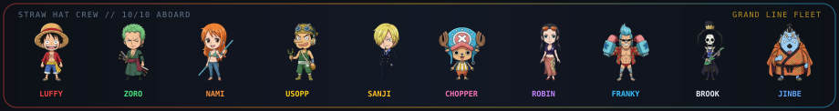
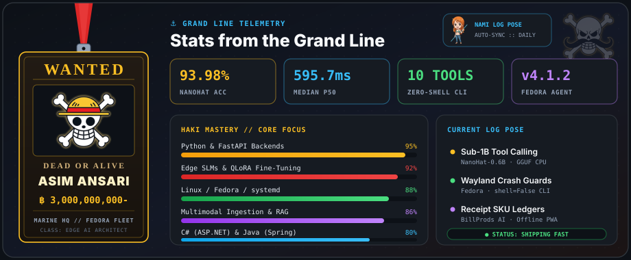
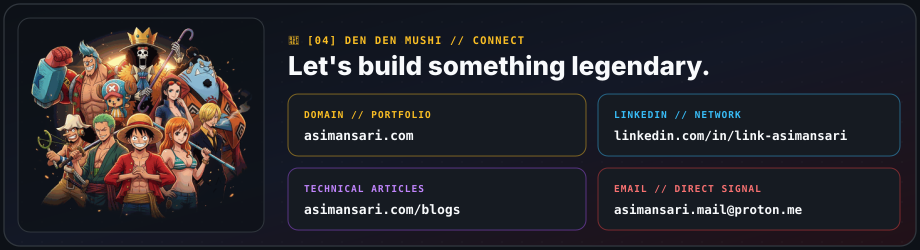

<!-- SECTION 1: HERO BANNER + FULL 10-MEMBER STRAW HAT CREW STRIP -->
<picture>
  
</picture>

<picture>
  
</picture>

 

<!-- SECTION 2: PHILOSOPHY & ENGINEERING PILLARS -->
<picture>
  
</picture>

 

<!-- SECTION 3: TECH STACK ARSENAL -->
<picture>
  
</picture>

 

<!-- SECTION 4: STATS FROM THE GRAND LINE -->
<picture>
  
</picture>

 

## 🏴‍☠️ Yonko-Tier Missions

| Mission | Core Stack | Engineering Impact |
| :--- | :--- | :--- |
| [**NanoHat OS Agent (v4.1.2)**](https://github.com/asimansari-git) | `NanoHat-0.6B` · `Ollama` · `Python` · `Fedora` · `systemd` | On-demand local Linux OS agent powered by `asimansari-o/nanohat` with a zero-shell (`shell=False`) direct-dispatch CLI driving **10 typed system tools** (`systemctl`, network, audio, GNOME, multi-GPU telemetry), Wayland session crash guards, `--sandbox` dry-run mode, **`93.98%`** canonical accuracy, and **`595.7ms`** median P50 latency. |
| [**Teaching Loop**](https://github.com/asimansari-git) | `Gemini Flash` · `ChromaDB (MMR)` · `Streamlit` · `Python` | Multi-user interactive AI tutoring and evaluation platform featuring dynamic Socratic dialogue, ChromaDB MMR vector retrieval over uploaded courseware, and Streamlit analytics dashboards. |
| [**BillProds AI**](https://github.com/asimansari-git) | `FastAPI` · `PostgreSQL` · `Gemini Multimodal` · `Offline PWA` | Granular product ledger and offline-first expense intelligence platform converting physical receipts into itemized SKU catalogs and relational ledgers via multimodal vision pipelines. |

 

<!-- SECTION 6: MY GRAND LINE VOYAGE (THOUSAND SUNNY + 3D ISOMETRIC CONTRIBUTION GRAPH) -->
<picture>
  
</picture>

<picture>
  <source media="(prefers-color-scheme: dark)" srcset="./profile-3d-contrib/profile-night-rainbow.svg" />
  <source media="(prefers-color-scheme: light)" srcset="./profile-3d-contrib/profile-green-animate.svg" />
  
</picture>

 

<!-- SECTION 7: DEN DEN MUSHI CONNECT FOOTER + CLICKABLE BADGES -->
<picture>
  
</picture>

 

  

<i>"Set sail, keep coding, keep shipping." 🏴‍☠️</i>

